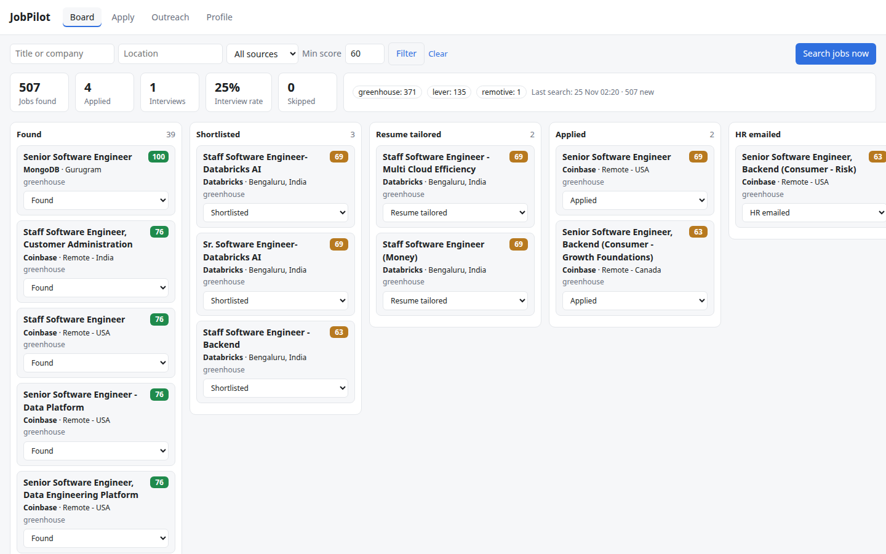
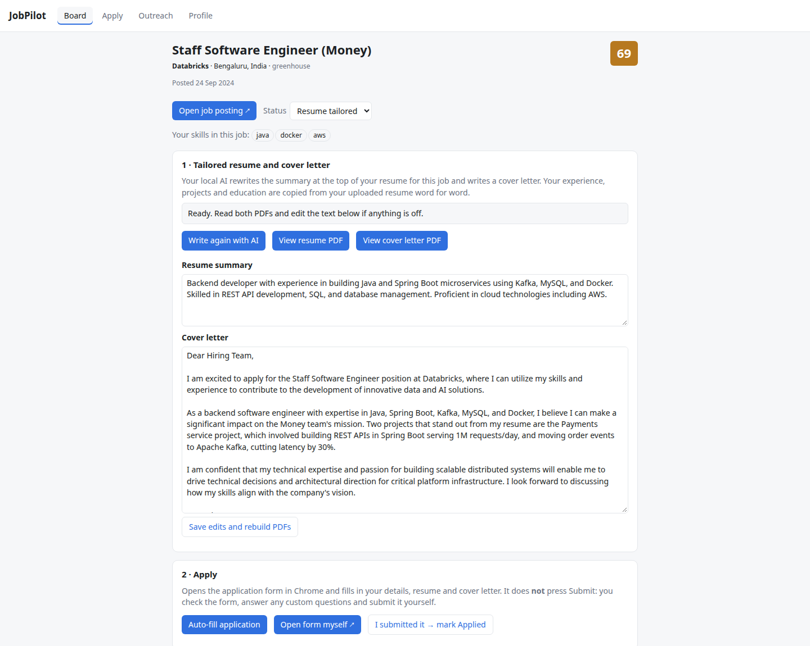
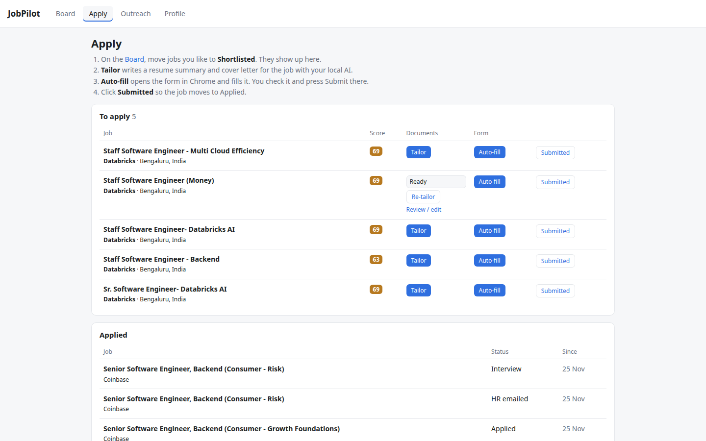

# JobPilot

A free, private job-search assistant that runs on your own computer.

- **Finds jobs** from company career boards (Greenhouse, Lever) and remote job feeds, filtered to your niche.
- **Scores** each job against your skills, titles and locations.
- **Tailors** a resume summary and cover letter for each job with a free local AI (Ollama), as PDFs.
- **Auto-fills** application forms in Chrome: your details, resume and cover letter. You review and press Submit.
- **Emails HR**: finds published hiring emails for a job, drafts a short note with your resume attached,
  and sends it from your own Gmail when you press Send. Follow-up reminders after 6 days.
- **Tracks** every job on a board: Found → Shortlisted → Tailored → Applied → HR emailed → Interview → Offer.

No accounts, no API keys, no paid services. Your resume and details never leave your computer except
when you fill in an application.

Built with Java 21+, Spring Boot 4, H2, Thymeleaf, Playwright, PDFBox and OpenHTMLtoPDF.

## Demo

JobPilot runs on your own computer (it uses your local AI and keeps your resume private), so there is no
public website to try. These screenshots are from a real run with a made-up demo profile.

**Board**: 507 real openings found in one search, scored against the profile and tracked through each stage.



**Tailoring**: the local AI (Ollama, llama3.2) wrote this resume summary and cover letter for the job, saved as PDFs.



**Apply**: shortlisted jobs ready to tailor and auto-fill, plus everything already applied to.



---

## 1. Install (once)

| What | Why | How |
|---|---|---|
| **Java 21 or newer** | Runs the app | Linux: `sudo apt install openjdk-21-jdk` · Mac/Windows: [adoptium.net](https://adoptium.net) |
| **Ollama** | Free local AI for resume and cover letter | [ollama.com/download](https://ollama.com/download), then `ollama pull llama3.2` |
| **Google Chrome** | Auto-filling forms | Optional. Without it, Playwright downloads its own Chromium the first time. |
| **Gmail App Password** | Sending outreach emails | Optional. Turn on 2-Step Verification, then create one at [myaccount.google.com/apppasswords](https://myaccount.google.com/apppasswords). |

You do **not** need Maven. The included `mvnw` script downloads it.

## 2. Get the code

```bash
git clone https://github.com/Rahul-web01/job-pilot.git
cd job-pilot
```

(Or download the ZIP from GitHub and unzip it.)

## 3. Run

Linux / Mac:

```bash
./mvnw spring-boot:run
```

Windows:

```bat
mvnw.cmd spring-boot:run
```

The first start takes a few minutes while it downloads libraries. When you see `Started JobPilotApplication`,
open **http://localhost:8080**. Stop it with **Ctrl+C**.

### Start it automatically (Linux)

So you don't need a terminal open, install it as a background service that starts when you log in:

```bash
./scripts/install-autostart.sh
```

Then just open **http://localhost:8080** any time. Run the same script again after pulling new code.
Check it with `systemctl --user status jobpilot`, see logs with `journalctl --user -u jobpilot -f`,
and undo it with `./scripts/uninstall-autostart.sh` (your data is kept).

## 4. Use it

1. **Profile tab**
   - Upload your resume (PDF). Check the text it read and fix anything jumbled.
   - Fill in your details (name, email, phone, LinkedIn…). These go into application forms.
   - Set your **niche**: job titles to look for, your skills, words to skip (e.g. `senior`), preferred locations.
   - Add companies to search: the name from `boards.greenhouse.io/<name>` or `jobs.lever.co/<name>`.
   - Save. The setup checklist at the top turns green when everything is ready.
2. **Board tab**
   - Press **Search jobs now**. It also searches by itself every 6 hours while running.
   - Filter by title, company, location, source and minimum score.
   - Move jobs you like to **Shortlisted** with the dropdown on each card.
3. **Apply tab**
   - **Tailor**: the AI writes a summary for the top of your resume and a cover letter for that job
     (30 seconds to a few minutes). Open the job to read and edit them; the PDFs rebuild when you save.
   - **Auto-fill**: Chrome opens the real application form and fills your details, resume and cover letter.
     It lists questions only you can answer. **Check everything and press Submit yourself.**
   - **Submitted**: moves the job to Applied.
4. **Email HR** (bottom of each job's page)
   - **Find emails** reads the job post and the company's own public pages (careers, contact, about) and
     lists the addresses it finds, with where each came from and how much to trust it. If nothing HR-like is
     published, it adds `careers@` / `hr@` / `recruiting@` as clearly marked guesses.
   - Know a recruiter's name? **Add someone yourself** with just the name, and it adds the usual address
     patterns (first.last@…) as guesses. Or paste an address you already know.
   - **Write email**: the local AI drafts a short note (greeting, 2 short paragraphs, your signature, a polite
     opt-out line) with your resume attached. Edit it, then press **Send**. It goes from your Gmail.
   - The **Outreach** tab lists drafts, sent emails and follow-ups due after 6 days (one per contact).
5. Back on the **Board**, move jobs to Interview / Offer / Rejected as replies come in.

## How it works

```
Profile (niche, resume) ─┐
                         ▼
Greenhouse / Lever / Remotive APIs ─▶ JobSearchService ─▶ JobMatcher (score 0–100) ─▶ H2 database ─▶ Board
                                                                                          │
                     Shortlisted job ─▶ TailorService ─▶ Ollama (local AI) ─▶ PdfService ─▶ resume.pdf + cover-letter.pdf
                                                                                          │
                                       ApplyService ─▶ Playwright + Chrome ─▶ FormFiller ─▶ you press Submit
                                                                                          │
   EmailFinderService (job post + company site, robots.txt) ─▶ contacts ─▶ OutreachService ─▶ Ollama draft
                                                                                          └▶ you press Send ─▶ Gmail SMTP
```

- **Score** = title match 30 + your skills found in the description (up to 50) + preferred location 20.
- **Tailoring is honest by design.** Only the summary and cover letter are AI-written. Your experience,
  projects and education are copied from your own resume word for word, so the AI can't invent a job or skill.
- **Outreach is opt-in, one email at a time.** Nothing is sent without your click, there's a daily limit
  (20 by default), and every email offers an easy opt-out. Guessed addresses are labelled as guesses.
- **Auto-fill never submits.** Automated submissions often go wrong (wrong answers to screening questions,
  CAPTCHAs), so the final click is always yours.

### Code map

| Folder (`src/main/java/com/jobpilot/`) | What it does |
|---|---|
| `source/` | One class per job platform. Add a platform by adding a class that implements `JobSource`. |
| `search/` | Runs all sources, scores, removes duplicates, saves. |
| `profile/` | Your profile and resume upload (PDF text extraction). |
| `tailor/` | Ollama client, prompt, PDF generation. Templates in `resources/templates/pdf/`. |
| `apply/` | Playwright form filling for Greenhouse and Lever. |
| `outreach/` | Email finder (job post, company site, patterns), drafting, Gmail sending, follow-ups. |
| `web/` | Pages: Board, Apply, Outreach, Profile, job details. |

### Your data

Everything is in the `data/` folder next to the app: the database (including your Gmail App Password, if you
saved one), your uploaded resume and the generated PDFs per job. Back it up if you care about your history; delete it to start fresh. It is in `.gitignore`, so
it is never pushed to GitHub.

## Sharing with friends

Each person runs their own copy on their own computer (steps 1–3 above). That keeps it free, and everyone's
resume and job list stays private. The app only listens on `localhost`, so nobody else on your Wi-Fi can open it.

## Tests

```bash
./mvnw test
```

`FormFillerTest` fills a local copy of a Greenhouse-style form with fake data (needs Chrome) and checks
that it never submits. `MailServiceTest` sends through a fake local mail server, so nothing really goes out.

## Limits

- Auto-fill covers Greenhouse and Lever forms. For other sites, open the posting and use the PDFs.
- LinkedIn, Naukri and Indeed are not scraped. Their terms forbid it and accounts get banned.
- Many companies don't publish a hiring email. Then you'll only get guesses, which may bounce. A recruiter's
  name from the careers page or LinkedIn (looked up by you) plus "Add someone yourself" works better.
- Replies aren't read automatically yet: press **They replied** when someone answers.
- The small default model (`llama3.2`) writes simply. Bigger free models (`ollama pull qwen2.5:7b`, then set it on
  the Profile tab) write better but need more RAM and time.
- The tailored resume is a clean, plain layout built from your resume text. If you prefer your own design,
  use your original PDF.

## Roadmap

- [x] Job search, filters, scoring, status board
- [x] Profile tab with resume upload and niche settings
- [x] Tailored resume and cover letter with local AI
- [x] Auto-fill Greenhouse and Lever applications
- [x] Find HR emails, draft and send outreach, follow-up reminders
- [ ] Read Gmail replies and move jobs to Interview / Rejected automatically

## License

MIT. See [LICENSE](LICENSE).
