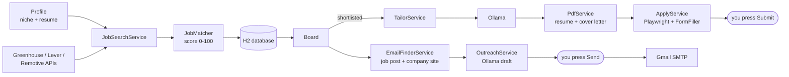

<div align="center">

# JobPilot

**A free, private job-search assistant that runs on your own computer.**

Find jobs, score them against your profile, tailor a resume and cover letter with a local AI,
auto-fill applications and email HR. No accounts, no API keys, no paid services.


[](LICENSE)

</div>

---

## Why

Applying to jobs means the same chores over and over: checking career pages, rewriting cover letters,
retyping your details into forms, hunting for a recruiter's email. JobPilot automates the repetitive parts
and leaves every decision (what to apply to, what to send, when to press Submit) to you.
Your resume and details stay on your machine except when you fill in an application.

## Features

- **Finds jobs** from company career boards (Greenhouse, Lever) and the Remotive remote-jobs feed, filtered to your niche.
  Search on demand, or let it run automatically every 6 hours while the app is open.
- **Scores** each job 0–100 against your target titles, skills and locations.
- **Tailors** a resume summary and cover letter per job with a local AI (Ollama), exported as PDFs.
- **Auto-fills** Greenhouse and Lever application forms in Chrome with your details, resume and cover letter. You review and press Submit.
- **Emails HR**: finds published hiring emails for a job, drafts a short note with your resume attached,
  and sends it from your own Gmail when you press Send. Follow-up reminders after 6 days.
- **Tracks** every job on a board: Found → Shortlisted → Resume tailored → Applied → HR emailed → Interview → Offer (or Rejected / Skipped).

## Screenshots

These are from a real run with a made-up demo profile. JobPilot uses your local AI and keeps your resume private,
so there is no public site to try.

**Board**: 507 real openings found in one search, scored against the profile and tracked through each stage.


**Tailoring**: the local AI (Ollama, llama3.2) wrote this resume summary and cover letter, saved as PDFs.


**Apply**: shortlisted jobs ready to tailor and auto-fill, plus everything already applied to.


## How it works



**Design choices**

- **Score** = title match 30 + your skills found in the description (up to 50) + preferred location 20.
  Titles containing your "skip" words are dropped.
- **Tailoring is honest by design.** Only the summary and cover letter are AI-written. Experience, projects and
  education are copied from your resume word for word, so the AI can't invent a job or skill.
- **Cover letters are built, not free-written.** JobPilot splits your resume into roles and projects, picks the
  best-matching internship or job and project, and asks the AI to rewrite only those lines. If a paragraph adds a
  number, technology or cliché ("excited", "passion"…) that isn't in your resume, a plain version of your own
  lines is used instead. Still read every letter: a small local model can word a fact oddly.
- **Outreach is opt-in, one email at a time.** Nothing is sent without your click, there is a daily limit
  (20 by default, adjustable on the Profile tab), every email offers an easy opt-out, and guessed addresses are
  labelled as guesses. The email finder respects `robots.txt`.
- **Auto-fill never submits.** Screening questions and CAPTCHAs make automated submissions unreliable, so the final click is yours.

## Tech stack

| Layer | Technology |
|---|---|
| Language | Java 21+ |
| Framework | Spring Boot 4.1 (Web MVC, Data JPA, Validation, Mail, Scheduling) |
| UI | Thymeleaf server-rendered pages |
| Database | H2, file-based, stored in `./data` |
| AI | Ollama over its local HTTP API (default model `llama3.2`) |
| Browser automation | Playwright for Java |
| PDF | PDFBox (read resume), OpenHTMLtoPDF (generate resume and cover letter) |
| HTML parsing | jsoup |
| Testing | JUnit 5, AssertJ, GreenMail (fake SMTP server) |

## Getting started

### Prerequisites

| What | Why | How |
|---|---|---|
| **Java 21 or newer** | Runs the app | Linux: `sudo apt install openjdk-21-jdk` · Mac/Windows: [adoptium.net](https://adoptium.net) |
| **Ollama** | Local AI for resume and cover letter | [ollama.com/download](https://ollama.com/download), then `ollama pull llama3.2` |
| **Google Chrome** | Auto-filling forms | Optional. Without it, Playwright downloads its own Chromium the first time. |
| **Gmail App Password** | Sending outreach emails | Optional. Turn on 2-Step Verification, then create one at [myaccount.google.com/apppasswords](https://myaccount.google.com/apppasswords). |

You do **not** need Maven installed: the included `mvnw` wrapper downloads it.

### Run

```bash
git clone https://github.com/Rahul-web01/job-pilot.git
cd job-pilot
./mvnw spring-boot:run
```

On Windows, use `mvnw.cmd spring-boot:run` instead of the last line.

The first start takes a few minutes while dependencies download. When you see `Started JobPilotApplication`,
open **http://localhost:8080**. Stop it with **Ctrl+C**.

### Start automatically on login (Linux with systemd)

```bash
./scripts/install-autostart.sh
```

This builds the jar and installs a user service, so http://localhost:8080 is available whenever you are logged in.
Re-run it after pulling new code. Check it with `systemctl --user status jobpilot` and follow logs with
`journalctl --user -u jobpilot -f`. To remove it, run `./scripts/uninstall-autostart.sh` (your data is kept).

### Run the tests

```bash
./mvnw test
```

`FormFillerTest` fills a local Greenhouse-style form with fake data and checks that it never submits
(skipped if Chrome is not installed). `MailServiceTest` sends through a fake local mail server, so nothing really goes out.

## Usage

1. **Profile**: upload your resume (PDF) and check the extracted text; fill in your details (name, email, phone, LinkedIn…);
   set your niche (job titles, skills, words to skip such as `senior`, preferred locations); add companies by their
   board name from `boards.greenhouse.io/<name>` or `jobs.lever.co/<name>`. The setup checklist turns green when everything is ready.
2. **Board**: press **Search jobs now**, filter by title, company, location, source and minimum score, and move jobs you like to **Shortlisted**.
3. **Apply**
   - **Tailor**: the AI writes a resume summary and cover letter for the job (30 seconds to a few minutes). Edit them on the job page; the PDFs rebuild when you save.
   - **Auto-fill**: Chrome opens the real application form, fills it, and lists questions only you can answer. **Check everything and press Submit yourself.**
   - **Submitted**: moves the job to Applied.
4. **Email HR** (bottom of each job page)
   - **Find emails** reads the job post and the company's public pages (careers, contact, about) and lists addresses with their source
     and how much to trust them. If nothing HR-like is published, it adds `careers@` / `hr@` / `recruiting@` as marked guesses.
   - **Add someone yourself** with a recruiter's name to get the usual address patterns (first.last@…) as guesses, or paste a known address.
   - **Write email**: the AI drafts a short note with your resume attached. Edit it, then press **Send**.
   - The **Outreach** tab lists drafts, sent emails and follow-ups due after 6 days. Press **They replied** when someone answers.
5. Back on the **Board**, move jobs to Interview / Offer / Rejected as replies come in.

## Project structure

```
job-pilot/
├── src/main/java/com/jobpilot/
│   ├── source/     # One class per job platform (implement JobSource to add one)
│   ├── search/     # Runs all sources, scores, de-duplicates, saves
│   ├── profile/    # Profile and resume upload (PDF text extraction)
│   ├── tailor/     # Ollama client, prompts, PDF generation
│   ├── apply/      # Playwright form filling for Greenhouse and Lever
│   ├── outreach/   # Email finder, drafting, Gmail sending, follow-ups
│   ├── job/        # Job entity and pipeline statuses
│   ├── config/     # App properties and HTTP client setup
│   └── web/        # Controllers for Board, Apply, Outreach, Profile and job pages
├── src/main/resources/
│   ├── templates/  # Thymeleaf pages, plus pdf/ templates for resume and cover letter
│   └── application.yml
├── scripts/        # Linux autostart install / uninstall
└── docs/           # Screenshots
```

## Privacy and your data

- The app listens only on `127.0.0.1`, so nobody else on your network can open it.
- Everything lives in the `data/` folder next to the app: the database (including your Gmail App Password, if saved),
  your uploaded resume and the generated PDFs. On Linux and Mac the folder is made readable only by your user account.
- `data/` is in `.gitignore`, so it is never pushed. Back it up to keep your history; delete it to start fresh.
- To share with friends, each person runs their own copy. That keeps it free and keeps everyone's data private.

## Limits

- Auto-fill covers Greenhouse and Lever forms. For other sites, open the posting and use the PDFs.
- LinkedIn, Naukri and Indeed are not scraped: their terms forbid it and accounts get banned.
- Many companies don't publish a hiring email, so you may only get guesses, which can bounce. A recruiter's name
  (looked up by you) plus **Add someone yourself** works better.
- Replies aren't read automatically yet.
- The default model (`llama3.2`) writes simply. Larger models (for example `ollama pull qwen2.5:7b`, then set it on
  the Profile tab) write better but need more RAM and time.
- The tailored resume uses a clean, plain layout built from your resume text. If you prefer your own design, use your original PDF.

## What I learned

- Putting several third-party job APIs behind one `JobSource` interface.
- Driving a real browser with Playwright and filling forms that differ from site to site.
- Using a small local LLM carefully: constraining what it writes and checking every fact against the source resume.
- Building a private, local-first app with Spring Boot, Thymeleaf and an embedded database.

## Roadmap

- [x] Job search, filters, scoring, status board
- [x] Profile tab with resume upload and niche settings
- [x] Tailored resume and cover letter with local AI
- [x] Auto-fill Greenhouse and Lever applications
- [x] Find HR emails, draft and send outreach, follow-up reminders
- [ ] Read Gmail replies and move jobs to Interview / Rejected automatically

## Author

**Rahul Singh**

[](https://github.com/Rahul-web01)
[](https://www.linkedin.com/in/rahul-singh-cs)

## License

MIT. See [LICENSE](LICENSE).

---

<div align="center">

If you found this useful, consider giving it a ⭐

</div>
